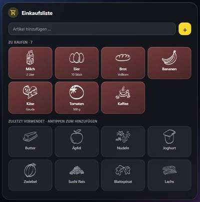

# Bring! Icon Card

A Home Assistant dashboard card that shows your shopping list as large, touch-friendly tiles with the item pictures you know from the Bring! app. Made for wall tablets.



- **Tap a tile** to check the item off.
- **Tap a recently used item** to put it back on the list.
- **Add items** with the input field at the top.
- Updates live: whatever someone adds or checks off in the Bring! app appears right away.
- Pictures are remembered on each device, so they show up instantly the next time.
- Typing suggests recently used items, and re-adding one reuses it instead of creating a duplicate.
- German and English labels, picked from your Home Assistant language.

> Not affiliated with or endorsed by Bring! Labs AG. "Bring!" is a trademark of its owner.

## Requirements

- Home Assistant with the official [Bring! integration](https://www.home-assistant.io/integrations/bring/) set up.
  The card also works with any other `todo` entity, but item pictures only make sense for Bring! lists.

## Installation

### Marketplace (recommended)

1. In Home Assistant go to **Settings → Marketplace**.
2. Select **Add from link** and enter `crankstyles90-hash/bring-icon-card`.
3. Install **Bring! Icon Card** and reload your browser.

### Manual

1. Download `bring-icon-card.js` from the [latest release](https://github.com/crankstyles90-hash/bring-icon-card/releases).
2. Copy it to `config/www/`.
3. Add it as a dashboard resource: **Settings → Dashboards → ⋮ → Resources → Add**, URL `/local/bring-icon-card.js`, type *JavaScript module*.

## Configuration

All main options can be set in the visual card editor. In YAML:

```yaml
type: custom:bring-icon-card
entity: todo.home
```

| Option      | Default | Description |
|-------------|---------|-------------|
| `entity`    | –       | **Required.** Your Bring! list, e.g. `todo.home`. |
| `title`     | none    | Optional heading above the card. |
| `columns`   | `4`     | Number of tiles per row. |
| `recent`    | `12`    | How many recently used items to show. `0` hides the section. |
| `images`    | `true`  | Set to `false` to show only initials. |
| `image_url` | Bring! web assets | Picture address with `{key}` as placeholder for the item name. |

### Use it as a pop-up (Bubble Card)

```yaml
type: vertical-stack
cards:
  - type: custom:bubble-card
    card_type: pop-up
    hash: '#shopping'
    name: Shopping list
    icon: mdi:cart-outline
  - type: custom:bring-icon-card
    entity: todo.home
```

Open it from anywhere on your dashboard with a link to `#shopping`.

### Colors

The card follows your theme. You can change the tile colors with these CSS variables (for example with card-mod):

| Variable | Used for |
|----------|----------|
| `--bic-open-from`, `--bic-open-to` | Gradient of open items |
| `--bic-open-border` | Border of open items |
| `--bic-accent` | Add button and input focus |
| `--bic-image-filter` | Picture color. Default is white; use `none` for the original dark pictures on light themes |

## How the pictures work

Bring! does not offer an official API for its item pictures. The card loads them from the address the Bring! web app uses. Because the picture names don't always match what people type ("Zwiebel" vs. "Zwiebeln", "Sushi Reis" → "Reis"), the card tries plural forms and word parts. Items without a picture show their first letter, just like in the app. Every device remembers which picture belongs to which item, so the search only happens once.

If Bring! changes that address, the pictures disappear and initials are shown instead. The list keeps working.

## License

MIT
